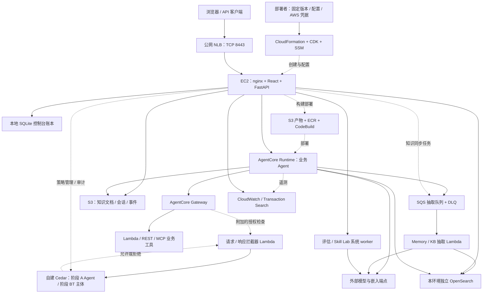
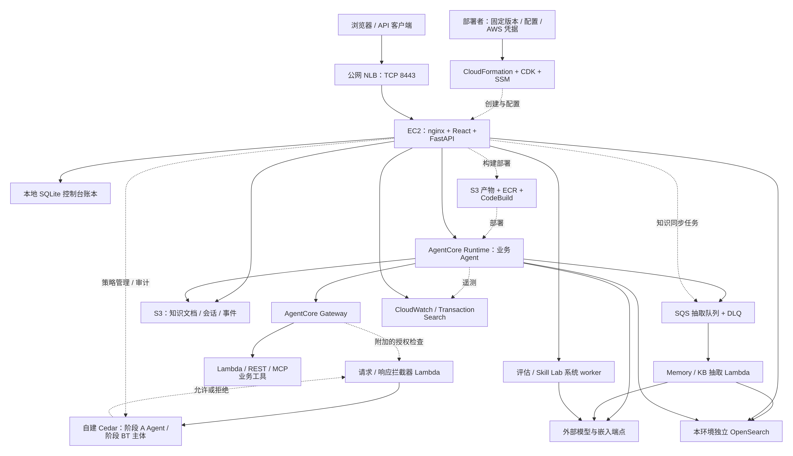

# AgentCore Launchpad 中国区版

一个把 **Agent 创建 → 部署 → 对话 → 工具授权 → 观察 → 评测** 串成一条流程的控制台。基于 [AWS Samples 的 AgentCore Launchpad](https://github.com/aws-samples/sample-agentcore-launchpad) 扩展，使用 React、FastAPI、AWS CDK 和 Amazon Bedrock AgentCore 构建。

本仓库的部署入口在 **AWS 中国（宁夏）`cn-northwest-1`** 完成验证，部署脚本目前只接受该区域。中国区的 Harness、Registry、Knowledge Base、Memory 与 Cedar 策略均为自建实现，与 Global 托管服务的部署说明不通用。

仓库不附带任何业务环境数据库或凭据，新部署不会复制历史会话，也不会自动生成验收结果。

## 目录

- [文档导航](#文档导航)
- [功能概览](#功能概览)
- [架构](#架构)
- [部署独立平台](#部署独立平台)
- [首次部署验收](#首次部署验收)
- [初始化 IT 服务台实验](#初始化-it-服务台实验)
- [更新、恢复与清理](#更新恢复与清理)
- [常见问题](#常见问题)
- [版本、验证范围与边界](#版本验证范围与边界)
- [仓库结构](#仓库结构)
- [来源与许可证](#来源与许可证)

## 文档导航

| 目标 | 从这里开始 |
| --- | --- |
| 首次部署一套独立平台 | 本文 [部署独立平台](#部署独立平台)；完整契约见 [中国区分发指南](docs/cn/distribution.md) |
| 平台就绪后准备培训 | [IT 服务台实验初始化](samples/itsm-cn/README.md) |
| 运维已部署的环境 | [生产运行手册](docs/agent-runbook-prod.md)、[部署与更新契约](docs/cn/interfaces/deploy.md)。升级走更新流程，不重跑首次安装 |
| 获取固定版本与产物 | 上游分支 [cn-region](https://github.com/aws-samples/sample-agentcore-launchpad/tree/cn-region)；策略引擎 ARM64 产物按下文 `make policy-engine-artifact` 本地构建 |
| 参与开发 | [AGENTS.md](AGENTS.md)、[本地开发运行手册](docs/agent-runbook-dev.md) |

## 功能概览

| 能力 | 内容 | 边界 |
| --- | --- | --- |
| Agent 创建与部署 | 自建 Harness、Strands Studio 可视化画布、BYOC 代码包或容器，统一部署到 AgentCore Runtime；控制台流式对话或 API 调用 | — |
| MCP、工具与 Skills | 注册、审核、挂载工具和技能；通过 Gateway 接入 Lambda、REST API 或外部 MCP 服务 | 企业系统的网络、凭据与接口需另行配置 |
| Cedar 工具授权 | 策略编辑、校验、发布、模拟、审计；分别判定 Agent 的阶段 A 权限与代表用户的阶段 BT 权限，支持前缀、实体比较与布尔条件 | 策略引擎需显式附加到 Gateway |
| 知识库 | 文档上传、同步、检索与 Agent 问答 | 底座为 S3 + OpenSearch，不是 Global 托管 Knowledge Bases |
| 跨会话记忆 | S3 保存会话状态，异步抽取事实、偏好、摘要并写入 OpenSearch；运行时按 Agent + 用户召回 | 共享工作区中控制台的记录可见性不等于私人记忆空间 |
| 观察与评测 | Trace、工具调用与策略审计；数据集、评估、建议生成与复评 | 依赖模型与系统 worker 就绪；代码评估器默认关闭；优化不保证提升评分 |
| 用户与工作区 | 用户审批、角色与资源授权；跨账号工作区 | 跨账号需在目标账号配置信任角色 |

## 架构

实线为主要调用或数据流，虚线为部署、绑定或遥测。Gateway 拦截器与策略引擎必须显式附加；图中的授权链不是基础 Gateway 的默认状态。



<details>
<summary>上图未显示时（例如网络访问不到 GitHub 的图表渲染服务），点此查看静态图</summary>



</details>

几点说明：

- 工具请求由拦截器判定；响应钩子参与结果与时序审计。
- Cedar 策略、业务 Runtime 与控制台是三个独立组件：升级控制台不会自动更新已部署的 Agent。
- Trace 的 `aws/spans` 来源属于工作区所选账号与区域。管理员诊断可能看到历史或其他环境的记录；成员只看到可访问 Agent 的来源。验收时按本次 Runtime、完整 session 与时间范围核对。
- 模型调用需要有效的供应商凭据。

### 部署范围

| 范围 | 独立部署默认创建的内容 |
| --- | --- |
| 主机与入口 | 本环境 VPC、子网、路由、安全组、EC2、主机 EIP、NLB 及其 EIP、TLS、前后端与 systemd 服务 |
| 构建与运行底座 | S3 产物桶、ECR、CodeBuild、IAM 角色；业务 Agent 的 Runtime 在创建 Agent 时部署 |
| 数据与记忆 | 独立 OpenSearch 域、FGAC 与索引、管理角色与发现参数、抽取 Lambda、SQS 与 DLQ |
| 策略与基础示例 | 两类策略分片及相关 KMS、网络、审计组件；HR 数据库 Lambda、office-facts API、基础 Gateway。策略附加需另行配置 |
| 系统能力 | bootstrap 安装评估与 Skill Lab worker；安装失败会降级并记录原因，需核对实际就绪状态 |
| 账号级或外部依赖（不创建） | CDKToolkit、AgentCore Identity、账号级可观测设施、部署者提供的 release 桶、SSM 密钥、模型服务。不会创建新的 AWS 账号 |
| IT 服务台实验（另行初始化） | 通过 `workshop.py all` 单独执行，不属于首次部署 |

## 部署独立平台

### 1. 准备条件

| 项目 | 要求 |
| --- | --- |
| AWS 账号 | 中国区账号与 `cn-northwest-1` 的部署凭据；具备 CloudFormation/CDK、EC2、IAM、SSM、S3、ECR、CodeBuild、Lambda、OpenSearch、AgentCore 等权限 |
| 配额 | 全新默认配置通常需要 1 个 VPC、1 个 IGW、2 个 EIP，另需 EC2、OpenSearch、AgentCore 容量。预检查需要 `servicequotas:GetServiceQuota`、EC2 Describe 与 CloudFormation ListStackResources 权限；配额申请中不等于已生效 |
| 操作机 | Git、AWS CLI、uv。本地构建策略引擎还需要 Rust 与 ARM64 交叉编译器 `gcc-aarch64-linux-gnu`。EC2 上的 Python、Node 等由模板安装 |
| 模型凭据 | 有效的 Global Bedrock API key，可访问所配置的对话与嵌入模型。模型推理跨中国区边界调用 Global 端点；其他供应商需另行配置 |
| SSM 参数 | 在目标区域预先保存三份 SecureString：模型 key、管理员密码、私有仓库只读 deploy key。前两项参数名必须是不含 `/` 的扁平名称；配置文件只写参数名，不写秘密值 |
| Release 桶 | 目标账号与区域内一个开启 Block Public Access 的私有 S3 桶，部署者向其上传模板；主机不需要该桶权限 |
| 仓库访问 | 操作机与新主机各自需要私有仓库读取权限。主机使用 SSH 地址加 SSM 中的 deploy key 克隆，不在 URL 中携带令牌 |

部署会产生实际费用。冷启动包含 OpenSearch 创建、构建与依赖下载，通常超过十分钟。

### 2. 获取固定版本并构建引擎

以下命令在操作机执行，使用固定发布标签。操作机检出与主机 `GitBranch` 必须指向同一版本。

```bash
git clone --branch cn-region --single-branch \
  https://github.com/aws-samples/sample-agentcore-launchpad.git
cd launchpad-cn
git rev-parse HEAD
cd backend
uv sync --frozen
cd ..
make policy-engine-artifact
```

产物与相邻的 `.sha256` 文件位于 `policy-engine/dist/`。不要使用来源不明的二进制。`GitBranch` 解析的是远程分支或标签，推荐不可变标签，不接受裸提交 SHA。

### 3. 配置目标环境

将 [部署配置样例](config/deploy-cn.example.json) 复制到仓库之外再编辑：

```bash
mkdir -p "$HOME/launchpad-deploy/run"
cp config/deploy-cn.example.json "$HOME/launchpad-deploy/deploy-cn.json"
```

编辑后的结构如下。所有 `YOUR_...` 占位符都必须替换；`lab` 只是示例，请选择一个未占用的环境名。

```json
{
  "account_id": "YOUR_12_DIGIT_ACCOUNT_ID",
  "region": "cn-northwest-1",
  "profile": "cn-northwest-1",
  "stack_name": "launchpad-cn-ec2-lab",
  "environment": "lab",
  "console_entry": "public_nlb",
  "release_bucket": "YOUR_PRIVATE_RELEASE_BUCKET",
  "engine_artifact": "/YOUR_ABSOLUTE_CHECKOUT/policy-engine/dist/launchpad-policy-engine-0.1.0-aarch64.tar.gz",
  "parameters": {
    "GitRepoUrl": "https://github.com/aws-samples/sample-agentcore-launchpad.git",
    "GitBranch": "cn-region",
    "GitDeployKeyParameter": "YOUR_GIT_DEPLOY_KEY_PARAMETER",
    "AllowedCidr": "YOUR_PUBLIC_IP/32",
    "GlobalBedrockApiKeyParameter": "YOUR_MODEL_KEY_PARAMETER",
    "ConsolePasswordParameter": "YOUR_ADMIN_PASSWORD_PARAMETER",
    "AuthPasswordPolicy": "relaxed",
    "AuthPasswordMinLength": 8,
    "InstanceType": "m7g.xlarge",
    "MemoryDomainMode": "dedicated",
    "ConsolePort": "8443",
    "TlsMode": "selfsigned"
  }
}
```

| 字段 | 说明 |
| --- | --- |
| `environment` / `stack_name` | 环境后缀为 1–3 位小写字母或数字，`kb` 为保留字；每个新环境使用未占用的名称和独立的 state 文件 |
| `profile` / `account_id` | AWS CLI profile 必须落到目标账号，脚本会核对 STS 身份 |
| `GitRepoUrl` / `GitBranch` | 有权限的中国区仓库与固定标签；使用自有 fork 时，fork 必须包含该标签 |
| `GitDeployKeyParameter` | 目标区域 SSM 中保存私有仓库只读 SSH key 的参数名，不是操作机上的 key 文件路径 |
| `engine_artifact` | ARM64 引擎产物路径，建议使用绝对路径；相对路径按配置文件所在目录解析。保留相邻的校验文件 |
| `console_entry` / `AllowedCidr` | `public_nlb` 时 NLB 的控制台监听向所有 IPv4 开放；`AllowedCidr` 只约束主机直连入口。`direct` 可跳过 NLB |
| `MemoryDomainMode` | `dedicated` 为本环境新建 OpenSearch 域；`shared` 显式复用账号区域内的既有域。修改该值不会迁移数据 |
| 密码策略 | 样例的注册规则为 `relaxed` / 8；省略参数时模板默认 `strict` / 12。管理员密码始终取自你指定的 SSM 参数 |
| TLS 与端口 | 当前分发使用自签名 HTTPS，端口范围 1024–65535，默认 8443；NLB 模式不能使用 8080 |

### 4. Plan、Apply 与访问

```bash
cd backend
uv run python ../scripts/deploy_cn.py plan \
  --config "$HOME/launchpad-deploy/deploy-cn.json" \
  --state "$HOME/launchpad-deploy/run/deployment.json"
uv run python ../scripts/deploy_cn.py apply \
  --config "$HOME/launchpad-deploy/deploy-cn.json" \
  --state "$HOME/launchpad-deploy/run/deployment.json"
uv run python ../scripts/deploy_cn.py status \
  --config "$HOME/launchpad-deploy/deploy-cn.json" \
  --state "$HOME/launchpad-deploy/run/deployment.json"
cd ..
```

| 子命令 | 作用 |
| --- | --- |
| `plan` | 读取 AWS 元数据并检查容量，不创建资源 |
| `apply` | 再次检查容量，创建资源，等待 bootstrap，安装策略引擎，执行就绪验证 |
| `status` | 读取 state 与当前资源状态 |

请完整保留 `run` 目录：其中的命令记录、资源归属与验证证据都用于中断恢复。

访问 state 中的 `outputs.ConsoleUrl`。`outputs.DirectConsoleUrl` 是受 `AllowedCidr` 限制的主机直连地址；NLB 模式下对外入口始终是 `ConsoleUrl`。不要使用首次启动时的临时地址。管理员账户名为 `admin`，密码即 `ConsolePasswordParameter` 所指参数的值。浏览器与 API 客户端需要信任自签名证书；正式域名与受信任证书属于后续运维配置。

## 首次部署验收

能登录控制台不等于全部能力就绪。至少核对以下五项：

1. state 中 `platform_ready`、`policy-install.json` 与 `deployment-verification.json` 均成功；CloudFormation 与 SSM 没有失败步骤。
2. `/api/health` 的 `build.sha` 对应后端版本，`build.dist_sha` 对应前端构建来源；`/api/auth/status` 的注册规则与配置一致。前端源码未变化时更新器会复用旧 dist，此时按内容等价核对，而不只比较 SHA。
3. 当前工作区的 OpenSearch endpoint、Memory 与 KB、模型与系统 worker 属于本环境。创建一个 Agent，得到一次真实模型回答，再验证知识检索与记忆的抽取和召回。
4. 用一条包含 `||` 的混合表达式完成策略的校验、发布、模拟与审计。先配置阶段 A 的 Agent 允许规则，再配置阶段 BT 的用户规则；预期结果是管理员与匹配工具允许、普通成员与无关工具拒绝。不要用全员允许的 BT 规则掩盖负例，`log_only` 放行也不算最终放行。
5. 实际工具调用结果与审计记录一致；模拟器不会真正调用工具。比较 Agent 版本时使用新会话，旧 Runtime 会话可能仍绑定旧版本。

## 初始化 IT 服务台实验

平台就绪后，在仓库根目录执行。先复制 [实验配置样例](samples/itsm-cn/config.example.json)，填写新控制台 URL、账号与区域、管理员密码的 SSM 参数、模型，以及一个独立的绝对路径 `state_dir`。

```bash
cp samples/itsm-cn/config.example.json "$HOME/launchpad-deploy/itsm-config.json"
# 编辑 itsm-config.json 后继续
export LAUNCHPAD_LAB_CONFIG="$HOME/launchpad-deploy/itsm-config.json"
uv run --project samples/itsm-cn samples/itsm-cn/scripts/workshop.py plan
uv run --project samples/itsm-cn samples/itsm-cn/scripts/workshop.py all
```

配置要点：

- `tools_host` 填目标环境中受 SSM 管理的 EC2，通常就是平台实例 `outputs.InstanceId`；`tools_user` 为 `ubuntu`。脚本不创建或删除 EC2。
- `lambda_subnet_cidr` 选择主机 VPC 内未占用的 `/24`。
- 脚本默认校验证书；可通过 `tls_verify` 指定可信 CA 文件，仅在受控实验中显式设为 `false`。

`all` 按 `console → tools → policy → staff → manual` 顺序执行：

| 阶段 | 内容 |
| --- | --- |
| console | 创建 `lab01`–`lab10` 与 `itdesk01`，随机凭据存入 SSM。已存在且不属于本次 run 的同名用户会使流程停止，不会重置其密码 |
| tools | 部署合成的 ServiceNow 风格工单与知识文章服务、10 个工具、Lambda 桥接、实验 Gateway 与网络规则。不连接真实的 ServiceNow |
| policy | 准备两阶段授权基线、requester 与 staff 策略 |
| staff | 创建 5 份中文文档、5 个 Skills、1 个知识库、教学与留出数据集，以及服务台参考 Agent |
| manual | 生成 `state_dir/IT服务台小助手-中国区实验手册.html` |

脚本不会创建学员 Agent、聊天历史或评测成绩，也不会代替学员完成八章操作。需要参考 Agent 时另行运行：

```bash
uv run --project samples/itsm-cn samples/itsm-cn/scripts/agents.py lab01 3
uv run --project samples/itsm-cn samples/itsm-cn/scripts/refresh_callers.py
```

requester 策略初始为 `log_only`，用于第三章前后对照；第四章切换为 `active`，并实测本人、冒用身份、staff 工具等正负案例。基线与 staff 限制已是 `active`，不代表 requester 规则已强制执行。

账号卡由管理员按 [实验指南](samples/itsm-cn/README.md) 单独发给学员，不要把凭据写入 README 或共享手册。初始手册中的参考图不是当前环境的验收证据；新截图与评测 summary 齐全后，沿用同一 `LAUNCHPAD_LAB_CONFIG` 生成最终手册：

```bash
uv run --project samples/itsm-cn samples/itsm-cn/scripts/build_manual.py --final
```

八章内容依次为：基础对话、知识与技能、工具、策略、记忆、观察、评测优化、知识闭环。

## 更新、恢复与清理

### 更新已部署环境

先阅读 [生产运行手册](docs/agent-runbook-prod.md) 与 [更新流程](docs/cn/interfaces/deploy.md#81-code-only-path--scriptshost-updatesh)。确认没有进行中的 Agent 对话、部署与评测任务，以及 Memory 消费状态，再安排更新窗口，并保留目标版本、旧版本与回滚资料。

更新使用 `scripts/host-update.sh`，主要参数为 `--root`、`--branch`、`--dry-run`、`--verify`、`--with-cdk`。从目标版本读取脚本并复制到检出目录之外再执行，避免脚本在运行途中被自身的 fast-forward 改写。

| 改动类型 | 做法 |
| --- | --- |
| 应用代码 | 脚本更新代码、依赖、必要的 dist、bootstrap 与服务，并在开始前备份 SQLite |
| CDK 或其 Lambda 资产 | 追加 `--with-cdk`，确认结果中没有 `cdk: pending`。EC2 与 NLB 的 CloudFormation 模板不在该标志的范围内 |
| 策略 Rust 引擎 | 另行构建并校验产物，按 [安装脚本](scripts/install_policy_host.sh) 安装 |
| Agent 模板、内嵌工具或知识配置 | 按变化重新部署相应 Agent，用新会话验证 |

更新后核对代码版本、实际进程配置、CDK 资产、前端构建与 Agent Runtime 版本。不要在有数据的主机上重跑 `bootstrap-host.sh`，也不要把新安装的 state 指向旧环境。

### 中断与失败恢复

保留原始 config、state、命令记录与实验 manifest。终端中断后，用同一配置、同一版本、同一 state 重复执行 `apply` 即可恢复。脚本拒绝配置变更、ref 移动与不属于本 state 的既有栈。遇到 `CREATE_FAILED` 先查看 CloudFormation 事件并修复原因；脚本不会自动删除重建，配额不足时也不会删除其他资源腾出空间。

合法修复导致主机更换时，恢复流程会重新绑定 SSM 命令与同网络内本环境的 NLB 目标。跨 VPC、端口、入口模式或版本的变化需要显式处理。实验 API 超时先核对实际资源再重试；不要并发运行修改同一 manifest 的脚本。

### 备份与清理

更新脚本的 SQLite 备份不是整套环境备份。按保留要求另行保存：SQLite 一致性备份、`config/launchpad.yaml`、`/etc/launchpad/env`、部署 state 与实验 manifest、S3 文档与产物、OpenSearch 数据。配置文件可能含有秘密，应加密并限制访问。OpenSearch 模式切换需要数据迁移与 Runtime 配置更新，只改 `MemoryDomainMode` 不够。

清理会删除数据。先完成备份并核对资源归属，按 [分发清理边界](docs/cn/distribution.md#updating-and-cleanup) 与 [NLB 删除顺序](docs/cn/interfaces/deploy.md#93-delete-and-the-teardown-order) 执行：

1. 在控制台或 API 中删除业务 Agent 等资源；按实验 manifest 核对实验专用的 Gateway、Lambda、网络与凭据。实验的 `reset` 只重置合成业务数据，不卸载云资源。
2. 记录 NLB 的 EIP allocation ID，先删除本环境的 NLB 栈，再处理主机栈。NLB 的 EIP 会被保留，确认不再使用后单独释放。
3. 在持有目标配置的操作机上执行 `scripts/teardown.py --dry-run`，显式设置正确的 `LAUNCHPAD_ENV_NAME` 与 `LAUNCHPAD_MEMORY_DOMAIN_MODE`；包含主机时同时设置 `LAUNCHPAD_EC2_STACK_NAME`。逐项核对后再加 `--yes`。
4. `dedicated` 模式只选择本环境的域；`shared` 域默认保留，`--delete-shared-domain` 带有最后使用者保护。不要因名称相似而删除其他环境的域。
5. 检查残留的 EIP、保留的 KMS key、日志、外部 release 桶与实验资源。账号级的 Transaction Search 等设施不属于环境 teardown。

## 常见问题

| 现象 | 优先核对 |
| --- | --- |
| 私有仓库克隆失败 | 分别检查操作机的 SSH 权限与主机的 SSM deploy key；配置使用 SSH 地址，key 对目标仓库有只读权限 |
| `plan` 失败 | 账号与 profile、固定 ref 与本地 HEAD 是否一致、产物路径与校验和、SSM 参数、私有桶、环境名冲突、有效配额与读取权限 |
| NLB 地址打不开 | 使用 state 中的最终 URL 与端口；核对 NLB target health、主机服务、安全组、证书 SAN；不要沿用 bootstrap 期间的临时 IP |
| 能登录但某项功能不可用 | bootstrap 的降级原因、模型权限、系统 worker、OpenSearch 与 FGAC |
| 注册仍要求不同的密码长度 | `/api/auth/status` 与实际 systemd 环境；省略参数时默认 `strict` / 12，代码 SHA 相同不代表配置相同 |
| 工具模拟或调用被拒绝 | Gateway 附加的引擎与模式、阶段 A 与阶段 BT 的判定、`active` 与 `log_only`、精确工具名；先排除缺少允许基线导致的默认拒绝 |
| 策略发布失败 | 具体的编译或 Gateway schema 错误与失败审计；确认原有 `active` 版本仍然有效 |
| 记忆抽取未立即完成 | 具体 actor 与 job、模型错误、队列重投与 DLQ。异步任务未完成不等于隔离失败 |
| 更新后看起来仍是旧版本 | `/api/health` 的 build、浏览器 bundle、实际进程、`cdk: pending`、Agent Runtime 版本与会话版本 |

更多诊断见 [故障排查](docs/troubleshooting.md) 与 [中国区接口契约](docs/cn/interfaces/)。

## 版本、验证范围与边界

| 项目 | 说明 |
| --- | --- |
| 当前发布 | 上游分支 `cn-region`（源 `cn/integration` 提交 `540937d1`）。ARM64 策略引擎产物及 `.sha256` 按「部署独立平台」第 2 步本地构建；部署配置样例见 `config/` |
| 验收路径 | 独立环境从空环境以 `d742e994` 部署，再经常规更新流程升级至 `4fd689c4 → 3ba2f2e → 7bea2813`，完成独立 OpenSearch、重复 apply、策略、Memory 与八章 GUI/API 验收 |
| 自动化验证 | `7bea2813` 上完整 `make verify` 通过：后端 12,731 个测试、基础设施 247 个、前端 970 个（131 个文件），以及 Rust、静态与构建检查 |
| 构建来源 | `.2` 的 ARM64 策略二进制复用自 `.1`，二者引擎源码树一致，来源记录于 release manifest。验收环境的前端 dist 构建自 `3ba2f2e`，与 `7bea2813` 的前端源码内容一致 |

默认模板是单 EC2、单 OpenSearch 数据节点、自签名 TLS 的部署形态，面向实验与演示，不是具备高可用、容量规划、灾备与企业身份集成的生产方案。独立环境不等于独立 AWS 账号，账号级可观测设施与外部模型仍是共享边界。云资源与模型调用会产生费用；生成式模型的延迟与质量不由部署脚本保证。

## 仓库结构

| 路径 | 内容 |
| --- | --- |
| [backend/](backend/) | FastAPI、部署与调用链、SQLite 账本、权限与自建服务 |
| [frontend/](frontend/)、[frontend/src/studio/](frontend/src/studio/) | React 控制台与集成的 Strands Studio |
| [infra/](infra/) | CDK 与 EC2、NLB 的 CloudFormation 模板 |
| [policy-engine/](policy-engine/) | Rust Cedar 引擎与 ARM64 产物构建 |
| [scripts/](scripts/) | 部署、更新、bootstrap、验证与 teardown |
| [config/](config/) | 可提交的配置样例；生成的配置与秘密不应提交 |
| [samples/itsm-cn/](samples/itsm-cn/) | IT 服务台初始化、合成服务、知识、Skills、数据集与手册源 |
| [docs/](docs/) | 架构、接口、运维、实验与历史验收说明 |

开发者先阅读 [AGENTS.md](AGENTS.md) 与 [本地开发运行手册](docs/agent-runbook-dev.md)。`make verify` 是代码改动的完整静态与隔离测试门禁，真实 AWS 端到端操作另行执行。[架构](docs/architecture.md)、[API](docs/api.md)、[跨账号工作区](docs/cross-account-workspaces.md)、[Studio 集成](docs/studio-integration.md) 与 [综合实验](docs/lab/README.md) 可供查阅；其中涉及 Global 的表述，以本文的中国区路径与 `docs/cn/interfaces/` 为准。

## 来源与许可证

上游项目：[aws-samples/sample-agentcore-launchpad](https://github.com/aws-samples/sample-agentcore-launchpad)。本仓库包含中国区实现与实验扩展，沿用 [MIT No Attribution 许可证](LICENSE)；第三方组件遵循各自的许可证。
